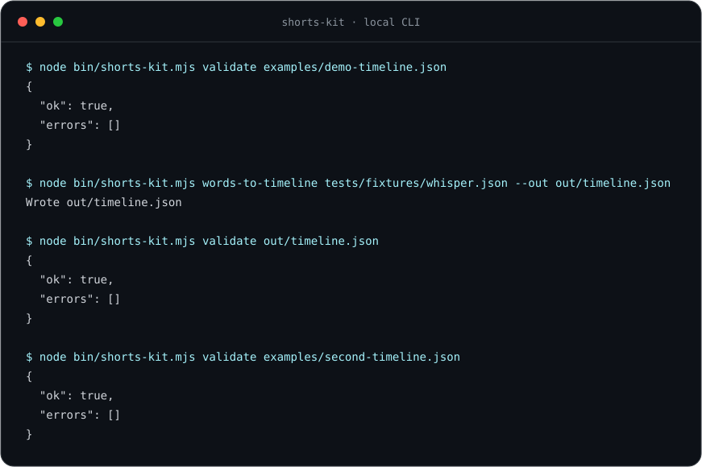
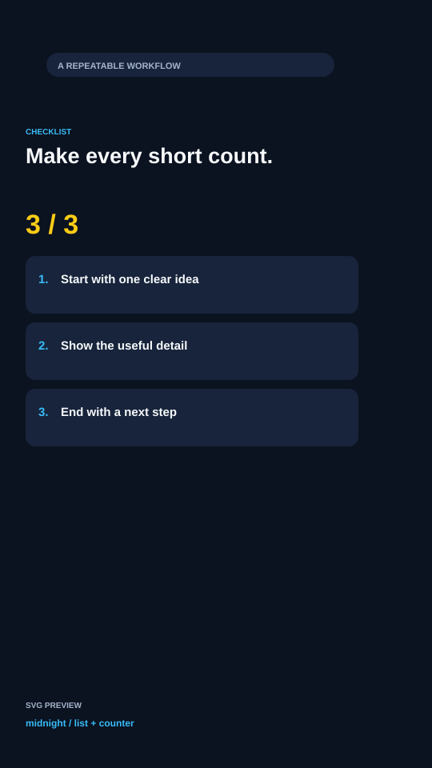
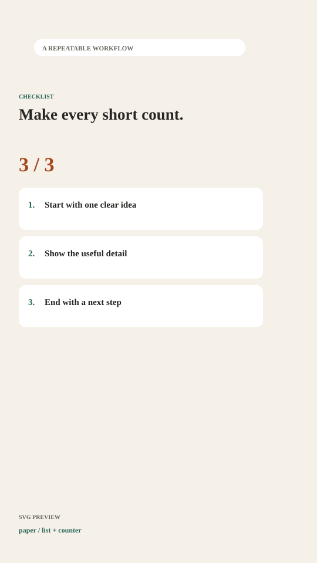
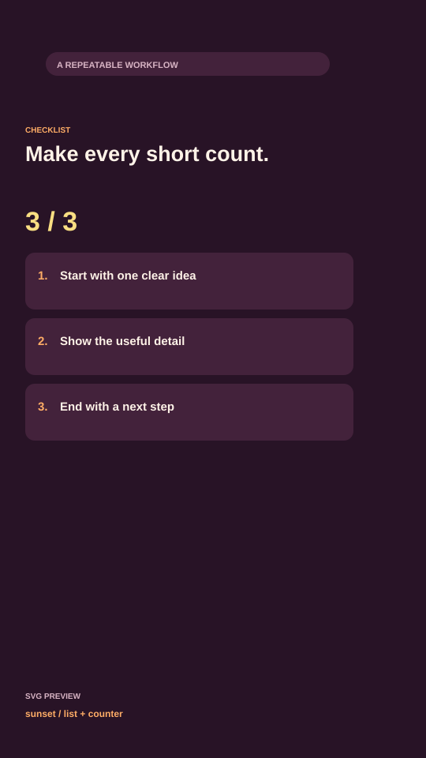
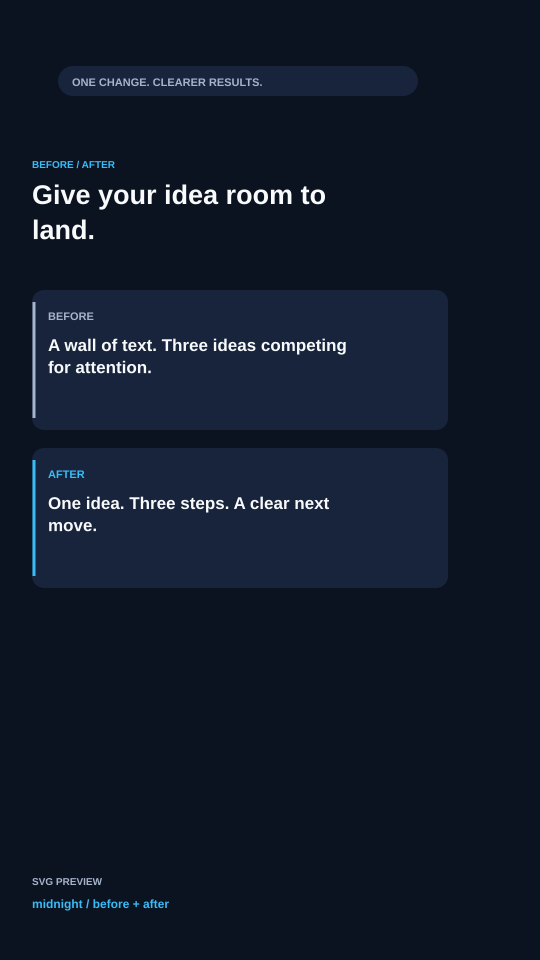
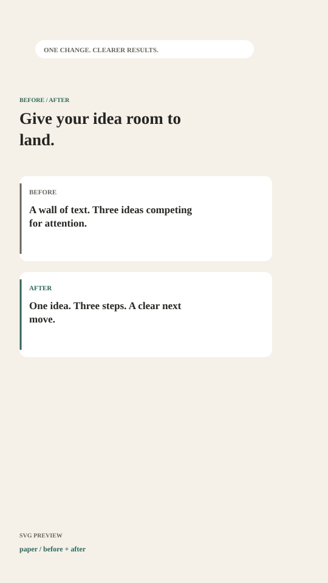
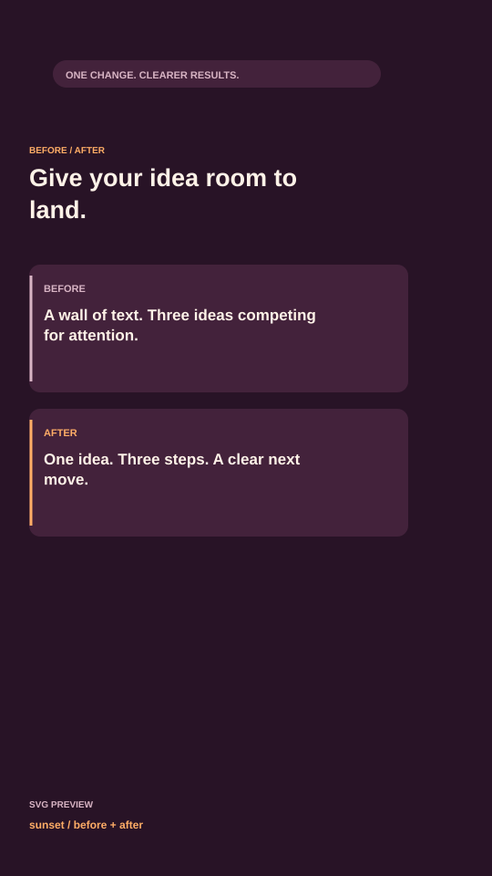
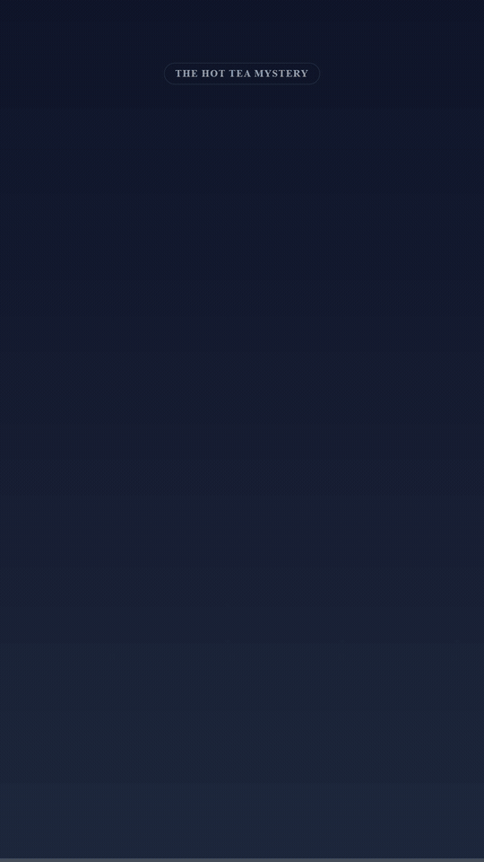

# remotion-shorts-kit

[](https://github.com/YusufBeratZengin/remotion-shorts-kit/actions/workflows/ci.yml) [](https://www.npmjs.com/package/remotion-shorts-kit) [](LICENSE) [](https://www.remotion.dev/) [](package.json)
[English](README.md) | [Türkçe](README.tr.md)

Turn JSON timelines into 1080×1920 explainer shorts with Remotion, word-level captions, and original SVG artwork.



## Why

- **Edit content as data:** one typed JSON timeline drives scenes, captions, callouts, arrows, and camera zooms.
- **Designed for vertical video:** word highlights and conservative safe-area defaults are ready for a 1080×1920 canvas.
- **Start locally, reuse anywhere:** clone the Studio starter or import React components; validation and Whisper conversion need no service credentials.

## Scene gallery

These are schematic SVG previews, using the same example content and theme palettes as Studio. Browser rendering could not be completed in this environment; the images are **not rendered video frames**.

| Template | Midnight | Paper | Sunset |
| --- | --- | --- | --- |
| List / counter |  |  |  |
| Before / after |  |  |  |

Regenerate the SVGs locally with `npm run docs:gallery`. In Studio, open `Templates-midnight`, `Templates-paper`, or `Templates-sunset`. With a working Chromium installation, capture actual 540×960 stills:

```bash
npx remotion still src/index.ts Templates-midnight docs/list-midnight.png --frame=90 --scale=0.5
npx remotion still src/index.ts Templates-midnight docs/before-after-midnight.png --frame=240 --scale=0.5
```

Replace `midnight` with `paper` or `sunset` for the other palettes. The JSON source is [examples/templates-timeline.json](examples/templates-timeline.json).

## Templates and themes

Add an optional `template` to any scene; existing titles, mascots, callouts, arrows, and zooms still work. Animations restart at the scene's start. Sizes target the existing 1080×1920 canvas.

```tsx
import { ExplainerShort, THEMES, createThemedTimeline } from "remotion-shorts-kit";

const timeline = createThemedTimeline({
  scenes: [
    {
      id: "steps", start: 0, end: 5,
      template: {
        type: "list", heading: "Three useful steps",
        items: ["Choose an idea", "Show the detail", "Make it useful"],
        intervalSeconds: 0.6,
      },
    },
    {
      id: "compare", start: 5, end: 10,
      template: {
        type: "before-after", heading: "A clearer message",
        before: { label: "BEFORE", text: "Too many competing ideas." },
        after: { label: "AFTER", text: "One clear next step." },
        revealSeconds: 1,
      },
    },
  ],
}, THEMES.paper);

export const MyTemplates = () => <ExplainerShort timeline={timeline} />;
```

- `list`: 1–5 nonempty items (up to 90 characters each), a heading (up to 80 characters), and a positive `intervalSeconds` (default `0.6`). The first item appears immediately; the revealed-item counter stops at the total.
- `before-after`: a heading (up to 80 characters), two `{ label, text }` panels (up to 30/180 characters), and a nonnegative `revealSeconds` (default `1`), followed by a 0.4-second fade. Timing is rounded to frames. Keep delays within the scene duration to show all content.
- `THEMES.midnight`, `THEMES.paper`, and `THEMES.sunset` each contain `fontFamily` and `colors: { background, surface, text, muted, accent, highlight }`. All fonts use local fallback stacks; no font downloads are needed. Customize with `{ ...THEMES.paper, fontFamily: "Arial, sans-serif", colors: { ...THEMES.paper.colors, accent: "#9333ea" } }`.

Call `createThemedTimeline(input, theme)` **before** the regular parser fills defaults. It supplies missing scene backgrounds, caption colors/fonts, callout colors, and arrow colors; explicit styles win. Its output stores the optional `theme` object for template/title typography and the progress bar. Passing already parsed data preserves its filled styles. A `theme` on raw JSON controls templates and shared chrome; use the helper to also fill caption/annotation defaults.

Existing timelines need no changes: `parseTimeline` / `TimelineSchema.parse` keep their original defaults and required background field. Only `createThemedTimeline` permits omitting backgrounds. `ThemeSchema`, `SceneTemplateSchema`, `ListTemplateSchema`, `BeforeAfterTemplateSchema`, their inferred types, and the standalone `SceneTemplateRenderer` are exported.

## Demo



The GIF is a 540×960 excerpt of the actual 20-second `ThermosExplainer` output, under 3 MB. [Static fallback](docs/demo-preview.svg).

JSON → schema defaults and validation → composition:

```tsx
import { ExplainerShort, TimelineSchema } from "remotion-shorts-kit";

const timeline = TimelineSchema.parse({
  scenes: [{ id: "intro", start: 0, end: 5, background: "#0f172a" }],
  captions: [{ text: "Hello!", start: 0.2, end: 1.2 }],
});
export const MyShort = () => <ExplainerShort timeline={timeline} />;
```

Register `MyShort` in your Remotion project's root. Importing this library does not register a root or include example compositions.

## Overview

Change a timeline instead of rebuilding scene sequencing, subtitle layout, mascot poses, callouts, arrows, and camera zooms. Clone this repository to use its Studio and example compositions, or import the components into an existing Remotion project.

## Features

- Zod schemas and declaration files for components, helpers, and timelines.
- Word highlights driven by frames, memoized line layout, and pause-aware caption batches.
- Original SVG robot Pip in five poses: idle, talking, explaining, thinking, and surprised.
- Callout cards, curved arrows, camera focus, progress bar, and a safe-area overlay.
- Local CLI for timeline validation and Whisper word conversion.

## Install

The npm badge reflects registry availability; until the first release, use the source starter in [Quick Start](#quick-start). Once published, install the library and its React 18 / Remotion 4 peers:

```bash
npm install remotion-shorts-kit react@18 react-dom@18 remotion@4
npx shorts-kit validate node_modules/remotion-shorts-kit/examples/demo-timeline.json
```

Zod is included as a runtime dependency. The package is ESM; CommonJS `require()` is not supported.

## Quick Start

### Prerequisites

Node.js 20 or newer and npm. Rendering also needs a supported Chromium installation; Remotion may download one on the first render.

### Installation

```bash
git clone https://github.com/YusufBeratZengin/remotion-shorts-kit.git
cd remotion-shorts-kit
npm ci
npm run build
node bin/shorts-kit.mjs validate examples/demo-timeline.json
```

Validation prints `{ "ok": true, "errors": [] }` and exits with code 0. This CLI check needs no browser or network service.

### Running the Studio

```bash
npm run studio
```

### Rendering the Demo Video

```bash
npm run render:demo
npm run render:example2
```

Outputs: `out/demo.mp4` (20 seconds) and `out/siphon.mp4` (15 seconds), both 1080×1920 at 30 fps. Both examples are silent; add your own narration.

### Testing and Code Quality

See [Development](#development) for the complete checks.

## Usage

The installed `shorts-kit` executable accepts raw timeline JSON:

```bash
node bin/shorts-kit.mjs validate examples/demo-timeline.json
node bin/shorts-kit.mjs validate examples/second-timeline.json
```

In an installed project, replace `node bin/shorts-kit.mjs` with `npx shorts-kit`. Invalid JSON, schema errors, and bad arguments exit with code 1. Validation reports paths such as `$.captions[1].start`.

`TimelineSchema.parse(json)` and `parseTimeline(json)` return a default-filled timeline or throw. `validateTimeline(json)` returns `{ ok: true, errors: [], data }` or `{ ok: false, errors: string[] }`; `safeParseTimeline` retains Zod's result shape.

## Examples

- [Thermos timeline](examples/demo-timeline.json): heat transfer, 20 seconds; `ThermosExplainer`.
- [Siphon timeline](examples/second-timeline.json): a full tube, lower outlet, and air breaking the flow, 15 seconds; `SiphonExplainer`, two mascot poses.
- [Whisper fixture](tests/fixtures/whisper.json): synthetic word timestamps for CLI practice.

## Configuration

The timeline JSON is the configuration: use `fps`, `width`, and `height` for the canvas, `captionStyle` for subtitles, and `audio` for narration. `remotion.config.ts` holds starter render settings. No environment variables or API keys are required.

To regenerate the terminal image from real CLI output after changing the examples or CLI:

```bash
npm run docs:demo
```

This builds the library, runs the documented validation/conversion commands, writes `out/timeline.json`, and refreshes `docs/demo.svg`. CI checks that the image stays in sync.

## Timeline JSON Reference

The full schema is in [src/schema.ts](src/schema.ts). Scene order is preserved; scene intervals cannot overlap. Caption words must be sorted and cannot overlap. Touching end/start boundaries are allowed.

### Top-Level Fields

| Field | Default | Meaning |
| --- | --- | --- |
| `scenes` | required | Nonempty array of scenes with `id`, `start`, `end`, and `background` |
| `fps`, `width`, `height` | `30`, `1080`, `1920` | Frame rate and canvas size |
| `captions` | `[]` | Words: `{ text, start, end, confidence? }`, times in seconds |
| `audio` | absent | `{ src, volume: 1, startOffset: 0 }`, offset in seconds |
| `captionStyle` | schema defaults | Font, highlight, line layout, and caption position |
| `theme` | omitted | Optional shared theme object; see Templates and themes |
| `showSafeArea` | `false` | Studio/Player guide; hidden in final renders by default |
| `showProgressBar` | `true` | Playback progress |

### Scene Definition

Each scene has `id`, `start`, `end` (seconds), and a CSS `background`; optional `title`, `template`, `mascot`, and `elements`. `mascot` accepts `{ pose, x, y, scale: 1, flip: false }`. `x`/`y` are canvas coordinates.

### Scene Elements

- `callout`: `id`, `x`, `y`, `text`; optional `title`, `icon`, and colors.
- `arrow`: `id`, `fromX`, `fromY`, `toX`, `toY`; optional label, color, stroke width, curvature.
- `zoom`: `id`, `targetX`, `targetY`; optional `scale` and `durationFrames`.

All elements accept optional `start`/`end` offsets in seconds relative to their scene. End boundaries are exclusive.

## Component Props Reference

See [component declarations and source](src/components/index.ts) for all exported prop types. Existing component props are shared by the library and starter.

### `<Captions>`

Required `captions: Word[]`; optional `style: Partial<CaptionStyle>`, `batchingOptions`, and `className`. Default layout is two lines, 18 characters per line, 500 px from the bottom, with 60/180 px left/right margins.

### `<Mascot>`

Required `pose`, `x`, `y`; optional `scale`, `flip`, `enterFrame`, `className`, and `style`. Artwork changes with the pose prop.

### `<Callout>`

Required `text`, `x`, `y`; optional `title`, `icon`, `accentColor`, `backgroundColor`, `textColor`, and entrance animation props.

### `<Arrow>`

Required `fromX`, `fromY`, `toX`, `toY`; optional `label`, `color`, `strokeWidth`, `curvature`, and entrance animation props.

### `<ZoomTo>`

Required `targetX`, `targetY`, `children`; optional `scale`, `startFrame`, and `durationFrames`.

### `<ProgressBar>`

Optional `position` (`top`/`bottom`), `height`, `color`, and `backgroundColor`.

### `<SafeAreaOverlay>`

Optional `visible`, `platform`, `opacity`, `showInRender`, `className`, and `style`. `platform` changes the label; all platforms share conservative geometry. Use `visible` and `showInRender` together to include it in an exported frame.

## Bring Your Own TTS + Whisper Word Timestamps

### 1. Generate Voice Audio (e.g., ElevenLabs / OpenAI TTS)

Use narration you generated locally or already own. No paid service is required.

### 2. Extract Word Timestamps via Whisper

Use word timestamps from your local transcription workflow. The kit makes no TTS or transcription requests. Whisper JSON may contain `segments[].words`, top-level `words`, or a raw word array; both `word` and `text` keys are accepted. Timestamps must already be ordered and nonoverlapping.

### 3. Assemble Your Timeline JSON

```bash
npm run build
node bin/shorts-kit.mjs words-to-timeline tests/fixtures/whisper.json --out out/timeline.json
node bin/shorts-kit.mjs validate out/timeline.json
```

The converter writes a valid, complete timeline with one scene and `Word[]` captions. Edit the scene artwork and add `audio: { "src": "narration.mp3" }` after placing your audio in `public/`. No audio is bundled.

For Remotion's `--props` option, wrap the raw timeline in `{ "timeline": ... }`. For example, render the supplied timeline through the generic composition:

```bash
node --input-type=module -e "import fs from 'node:fs'; fs.writeFileSync('out/props.json', JSON.stringify({timeline: JSON.parse(fs.readFileSync('examples/demo-timeline.json','utf8'))}));"
npx remotion render src/index.ts ExplainerShort out/custom.mp4 --props=out/props.json
```

Local audio/image paths resolve under `public/`; a missing file in Studio/CLI renders raises an error naming `public/<file>`. SSR/Player environments without a public-file manifest retain Remotion's URL resolution. HTTP(S), data, and blob URLs pass through and may load external content.

## Safe Area Specifications

At 1080×1920, reserve 200 px at the top, 480 px at the bottom, 60 px on the left, and 180 px on the right for critical content. Captions default to 500 px above the bottom. These are conservative guides; platform interfaces change, so inspect your target platform before publishing. Nonstandard canvas sizes need adjusted layout values.

## How It Works

Zod fills defaults and checks timeline intervals. Frame time selects a scene and caption batch. React components render the artwork and frame-driven motion; Remotion exports the result. CLI output and library components use the same schema.

## Assets and Licensing

Pip and the supplied SVG illustrations are original project assets under [MIT](LICENSE). No copyrighted characters, bundled audio, or font files are included; typography uses system fonts. Third-party dependencies keep their own licenses. Review [Remotion's licensing terms](https://www.remotion.dev/license) for your use case.

## FAQ and Limitations

**Do I need a paid service?** The kit performs validation and word conversion locally. It includes no TTS or transcription service. Remotion has its own [license terms](https://www.remotion.dev/license).

**Can I use it before the npm release?** Yes: clone this repository and follow Quick Start. The npm badge may show that the package is unavailable until publication.

**Why does the CLI need a build?** It imports the generated `dist/` schema. Run `npm run build` after cloning or changing the schema; an installed package includes the build.

**Are the example videos narrated?** No. Supply your own audio and word timestamps using the workflow above.

Default coordinates target 1080×1920. No narration or transcription engine is bundled. Timelines and CLI processing stay local; remote asset URLs load from their respective hosts. Use synthetic data in bug reports and keep personal data and credentials out of timelines you share.

## Project Structure

- `src/index.ts`, `src/Root.tsx`: Studio/CLI registration and example compositions.
- `src/library.ts`: library entry, emitted to `dist/` with declarations.
- `src/components/`, `src/helpers/`, `src/schema.ts`: reusable rendering and validation.
- `examples/`, `bin/`, `tests/`: timelines, local CLI, and offline tests.
- `docs/demo.svg`, `scripts/make-demo.mjs`: reproducible terminal demo; `docs/demo.gif`: actual video excerpt. `out/` is ignored.

## Development

```bash
npm run lint
npm run typecheck
npm test
npm run docs:demo
npm run build
npm pack --dry-run
npx remotion still src/index.ts ThermosExplainer out/still.png --frame=60
npx remotion compositions src/index.ts
```

`npm test` builds the library, runs the tests, and prints V8 coverage. Coverage tracks helpers and the timeline schema, with at least 85% lines/statements and 80% branches/functions per file; HTML and JSON reports go to `coverage/`. Component rendering and CLI behavior have separate tests. CI runs Node 20/22/24 on Linux and Windows, checks the generated terminal demo, and uploads a Linux render-smoke still. CodeQL analyzes JavaScript/TypeScript on pushes, pull requests, and a weekly schedule.

## Contributing

Read [CONTRIBUTING.md](CONTRIBUTING.md), [CODE_OF_CONDUCT.md](CODE_OF_CONDUCT.md), [SECURITY.md](SECURITY.md), and [CHANGELOG.md](CHANGELOG.md). Use the [bug report](.github/ISSUE_TEMPLATE/bug_report.yml) or [feature request](.github/ISSUE_TEMPLATE/feature_request.yml) forms, follow the [PR checklist](.github/PULL_REQUEST_TEMPLATE.md), and see the [issue routing](.github/ISSUE_TEMPLATE/config.yml). [Dependabot](.github/dependabot.yml) checks npm and Actions monthly (grouped). Releases use the [tag workflow](.github/workflows/publish.yml) and npm trusted publishing.

## License

[MIT](LICENSE). Copyright (c) 2026 Yusuf Berat Zengin.
