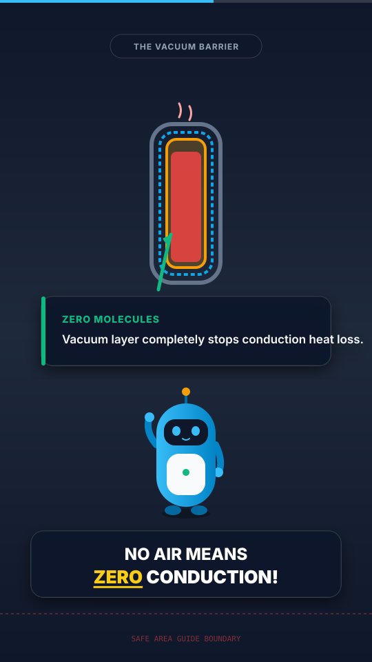

# remotion-shorts-kit

Open-source Remotion starter kit for programmatically creating 1080x1920 vertical explainer shorts.



## Overview

Producing mechanism-explainer shorts programmatically is popular across YouTube Shorts, TikTok, and Instagram Reels. However, developers and creators routinely rebuild the same infrastructure: word-level subtitle synchronizers, scene sequencers, mascot pose switches, directional pointer arrows, callout boxes, and safe-area margins.

`remotion-shorts-kit` provides a typed, tested, and modular foundation built on Remotion 4, React, TypeScript strict mode, and Zod. It separates creative assets and content timelines from rendering mechanics, allowing video pipelines to be driven purely by structured JSON.

## Features

- **Data-Driven Architecture**: Fully validated timeline schema via Zod (`src/schema.ts`).
- **Word-Level Animated Captions**: Synchronized to word timestamps with dynamic 1-2 line batching, pause detection, safe-area elevation, and active word pop highlights.
- **SVG Mascot System**: Original geometric robot mascot ("Pip") with 5 distinct poses (`idle`, `talking`, `explaining`, `thinking`, `surprised`) and squash/bounce entrance dynamics.
- **Visual Callouts and Pointers**: `<Callout>` spring cards, `<Arrow>` bezier pointers with attention pulses, and `<ZoomTo>` camera pan-and-scale effects.
- **Safe Area Guide**: A Studio-only overlay (`<SafeAreaOverlay>`) showing a conservative zone that avoids typical Shorts/TikTok/Reels UI. It is hidden in `remotion render` output unless you opt in with `showInRender`. The `platform` prop only changes the label; the geometry is one shared, conservative layout.
- **Unit-Tested Pure Helpers**: Standalone units for time-to-frame calculation, line breaking, scene lookup, and easing curves.
- **Render Pipeline**: npm scripts for Studio inspection and MP4 export through the Remotion CLI. Composition length, fps and size are derived from the timeline.

## Quick Start

### Prerequisites

- Node.js >= 20.0.0
- npm >= 10.0.0

### Installation

```bash
git clone https://github.com/YusufBeratZengin/remotion-shorts-kit.git
cd remotion-shorts-kit
npm install
```

### Running the Studio

Open the interactive Remotion Studio to preview animations, inspect layouts, and tweak parameters:

```bash
npm run studio
```

### Rendering the Demo Video

Render the 20-second 1080x1920 demo composition ("How a Thermos Keeps Tea Hot") to `out/demo.mp4`:

```bash
npm run render:demo
```

### Testing and Code Quality

```bash
# Run unit test suite via Vitest
npm run test

# Run strict TypeScript compiler verification
npm run typecheck

# Run Biome lint checks
npm run lint

# Auto-apply Biome format and lint fixes
npm run lint:fix
```

## Timeline JSON Reference

The rendering pipeline is driven by a `Timeline` object. The full schema is defined in `src/schema.ts` and validated with Zod.

### Top-Level Fields

| Field | Type | Default | Description |
| --- | --- | --- | --- |
| `fps` | `number` | `30` | Frame rate (frames per second). |
| `width` | `number` | `1080` | Canvas width in pixels. |
| `height` | `number` | `1920` | Canvas height in pixels. |
| `scenes` | `Scene[]` | (Required) | Array of sequential or time-indexed scenes. |
| `captions` | `Word[]` | `[]` | Word-level timestamped transcription. |
| `audio` | `AudioConfig` | `undefined` | Optional background or narration audio track. |
| `captionStyle`| `CaptionStyle`| `{}` | Global typography and visual style for subtitles. |
| `showProgressBar` | `boolean` | `true` | Display progress bar indicator at top or bottom. |
| `showSafeArea` | `boolean` | `false` | Show the safe-area guide in Studio/Player (never in `remotion render` output). |

### Scene Definition

```json
{
  "id": "scene-1-intro",
  "start": 0.0,
  "end": 4.0,
  "background": "linear-gradient(180deg, #0f172a 0%, #1e293b 100%)",
  "title": "The Hot Tea Mystery",
  "mascot": {
    "pose": "thinking",
    "x": 540,
    "y": 1320,
    "scale": 1.15,
    "flip": false
  },
  "elements": [
    {
      "type": "callout",
      "id": "temp-callout",
      "x": 540,
      "y": 660,
      "title": "Steaming Fresh",
      "text": "How does a flask keep tea hot for 12 hours?",
      "accentColor": "#f59e0b"
    }
  ]
}
```

### Scene Elements

- **Callout (`type: "callout"`)**: Floating text card with an accent indicator, title, body text, and optional icon.
- **Arrow (`type: "arrow"`)**: Directional pointer between `(fromX, fromY)` and `(toX, toY)` with configurable curvature, stroke width, color, and pulse animation.
- **Zoom (`type: "zoom"`)**: Focuses camera attention onto `(targetX, targetY)` with spring scaling during the scene.

## Component Props Reference

### `<Captions>`

Renders word-highlighted subtitle boxes broken across 1-2 lines.

| Prop | Type | Default | Description |
| --- | --- | --- | --- |
| `captions` | `Word[]` | (Required) | Array of `{ text, start, end }` objects. |
| `style` | `Partial<CaptionStyle>` | `{}` | Visual overrides (font, colors, padding). |
| `batchingOptions` | `BatchingOptions` | `{}` | Line breaking thresholds (maxChars, maxLines, pause threshold). |
| `className` | `string` | `undefined` | Optional CSS class name. |

### `<Mascot>`

Renders an original SVG character with pose-switching squash and bounce animations.

| Prop | Type | Default | Description |
| --- | --- | --- | --- |
| `pose` | `MascotPose` | (Required) | `"idle"` \| `"talking"` \| `"explaining"` \| `"thinking"` \| `"surprised"`. |
| `x` | `number` | (Required) | Horizontal center position in pixels. |
| `y` | `number` | (Required) | Vertical center position in pixels. |
| `scale` | `number` | `1` | Scaling factor. |
| `flip` | `boolean` | `false` | Mirror character horizontally. |
| `enterFrame` | `number` | `useCurrentFrame()` | Frame offset for the entrance animation. |

### `<Callout>`

Attention card with spring entrance animation.

| Prop | Type | Default | Description |
| --- | --- | --- | --- |
| `text` | `string` | (Required) | Main callout text. |
| `x` | `number` | (Required) | Center horizontal position in pixels. |
| `y` | `number` | (Required) | Center vertical position in pixels. |
| `title` | `string` | `undefined` | Header text above description. |
| `icon` | `string` | `undefined` | Leading icon character or symbol. |
| `accentColor` | `string` | `"#38bdf8"` | Border and highlight accent color. |
| `backgroundColor` | `string` | `"rgba(15,23,42,0.90)"` | Card background color. |

### `<Arrow>`

Animated vector arrow connecting two coordinates.

| Prop | Type | Default | Description |
| --- | --- | --- | --- |
| `fromX` | `number` | (Required) | Start X coordinate in pixels. |
| `fromY` | `number` | (Required) | Start Y coordinate in pixels. |
| `toX` | `number` | (Required) | Target X coordinate in pixels. |
| `toY` | `number` | (Required) | Target Y coordinate in pixels. |
| `label` | `string` | `undefined` | Floating text label along arrow shaft. |
| `color` | `string` | `"#f59e0b"` | Arrow stroke and arrowhead color. |
| `strokeWidth` | `number` | `8` | Line thickness in pixels. |
| `curvature` | `number` | `0` | Quadratic curve displacement in pixels. |

### `<ZoomTo>`

Wraps content and provides camera focus onto a specific coordinate.

| Prop | Type | Default | Description |
| --- | --- | --- | --- |
| `targetX` | `number` | (Required) | Focal point X coordinate in pixels. |
| `targetY` | `number` | (Required) | Focal point Y coordinate in pixels. |
| `scale` | `number` | `1.3` | Maximum zoom scale. |
| `startFrame` | `number` | `0` | Relative frame when zoom begins. |
| `durationFrames` | `number` | `30` | Duration of zoom transition. |
| `children` | `ReactNode` | (Required) | Scene elements being scaled. |

### `<ProgressBar>`

Displays video playback progression.

| Prop | Type | Default | Description |
| --- | --- | --- | --- |
| `position` | `"top"` \| `"bottom"` | `"bottom"` | Vertical placement on screen. |
| `height` | `number` | `8` | Thickness in pixels. |
| `color` | `string` | `"#38bdf8"` | Fill progress color. |
| `backgroundColor` | `string` | `"rgba(255,255,255,0.18)"` | Bar track color. |

### `<SafeAreaOverlay>`

Guides for vertical platform interfaces.

| Prop | Type | Default | Description |
| --- | --- | --- | --- |
| `visible` | `boolean` | `false` | Whether overlay is rendered. |
| `platform` | `SafeAreaPlatform` | `"all"` | `"all"` \| `"youtube-shorts"` \| `"tiktok"` \| `"instagram-reels"`. |
| `opacity` | `number` | `0.85` | Overlay transparency. |
| `showInRender` | `boolean` | `false` | Also draw the overlay in `remotion render` / `remotion still` output. |

## Bring Your Own TTS + Whisper Word Timestamps

This kit is designed to integrate cleanly with any automated voiceover and transcription workflow.

### 1. Generate Voice Audio (e.g., ElevenLabs / OpenAI TTS)

Generate your narration audio file in MP3 or WAV format:

```bash
# Example with OpenAI TTS API via curl
curl https://api.openai.com/v1/audio/speech \
  -H "Authorization: Bearer $OPENAI_API_KEY" \
  -H "Content-Type: application/json" \
  -d '{
    "model": "tts-1",
    "input": "Ever wondered how a thermos flask keeps tea piping hot? Heat naturally escapes in three ways: conduction, convection, and radiation...",
    "voice": "alloy"
  }' \
  --output public/narration.mp3
```

### 2. Extract Word Timestamps via Whisper

Run OpenAI Whisper with word-level timestamps enabled:

```bash
# Using OpenAI Whisper CLI
whisper public/narration.mp3 \
  --model base \
  --word_timestamps True \
  --output_format json \
  --output_dir .
```

Or using `faster-whisper` in Python:

```python
from faster_whisper import WhisperModel
import json

model = WhisperModel("base", device="cpu", compute_type="int8")
segments, info = model.transcribe("public/narration.mp3", word_timestamps=True)

words = []
for segment in segments:
    for word in segment.words:
        words.append({
            "text": word.word.strip(),
            "start": round(word.start, 2),
            "end": round(word.end, 2),
            "confidence": round(word.probability, 2)
        })

with open("captions.json", "w", encoding="utf-8") as f:
    json.dump(words, f, indent=2)

print(f"Extracted {len(words)} word timestamps.")
```

### 3. Assemble Your Timeline JSON

Inject the generated word array into your timeline file:

```json
{
  "fps": 30,
  "width": 1080,
  "height": 1920,
  "audio": {
    "src": "narration.mp3",
    "volume": 1.0
  },
  "captions": [
    { "text": "Ever", "start": 0.15, "end": 0.45 },
    { "text": "wondered", "start": 0.45, "end": 0.95 }
  ],
  "scenes": [...]
}
```

Audio and image paths in the timeline are resolved with Remotion's `staticFile()`, so `"narration.mp3"` (or `"/narration.mp3"`) means `public/narration.mp3`; `http(s)://` URLs are used as-is. Pass a timeline to the `ExplainerShort` composition with `--props`:

```bash
npx remotion render src/index.ts ExplainerShort out/video.mp4 --props=my-props.json
```

where `my-props.json` is `{ "timeline": { ... } }`. The video length is taken from the latest scene or caption end.

## Safe Area Specifications

Vertical short platforms overlay native user interface elements that cover edges of the screen.

- **Top Danger Zone (0 to 200px)**: Covered by platform search bars, sound selector tags, and status icons.
- **Right Danger Rail (920px to 1080px)**: Covered by action icons (Like, Dislike/Save, Comments, Share, Remix, Sound Disc).
- **Bottom Danger Zone (1440px to 1920px)**: Covered by account profile pictures, follow buttons, titles, audio attributions, and progress scrubbers.
- **Safe Content Box**: `left: 60px`, `top: 200px`, `right: 180px`, `bottom: 480px`. Keep all critical diagrams, pointer arrows, and character focal points within these bounds. Captions are kept inside that box by default: `positionBottom: 500` and a 180px right margin. The overlay is a development aid only: it is not drawn in final renders by default.

## Project Structure

```
remotion-shorts-kit/
├── .github/workflows/ci.yml    # Multi-platform GitHub Actions CI
├── docs/demo-preview.svg       # Architecture and visual preview mockup
├── examples/demo-timeline.json # 20-second thermos explanation timeline
├── src/
│   ├── assets/mascot/          # Raw SVG character assets
│   ├── components/             # Reusable UI and video components
│   │   ├── Arrow.tsx
│   │   ├── Callout.tsx
│   │   ├── Captions.tsx
│   │   ├── Mascot.tsx
│   │   ├── ProgressBar.tsx
│   │   ├── SafeAreaOverlay.tsx
│   │   ├── SceneRenderer.tsx
│   │   └── ZoomTo.tsx
│   ├── compositions/           # High-level Remotion compositions
│   │   └── ExplainerShort.tsx
│   ├── examples/               # Example implementations
│   │   └── ThermosExplainer.tsx
│   ├── helpers/                # Pure unit-tested algorithms
│   │   ├── assets.ts
│   │   ├── captions.ts
│   │   ├── easing.ts
│   │   ├── resolveAsset.ts
│   │   ├── scene.ts
│   │   └── time.ts
│   ├── Root.tsx                # Remotion Root composition registrations
│   ├── schema.ts               # Zod validation schemas and TypeScript types
│   └── index.ts                # Main package entrypoint
└── tests/                      # Vitest unit test suites
```

## Contributing

See [CONTRIBUTING.md](CONTRIBUTING.md) for contribution guidelines, testing instructions, and commit conventions.

## License

This project is licensed under the MIT License. See [LICENSE](LICENSE) for details.

Copyright (c) 2026 Yusuf Berat Zengin.
